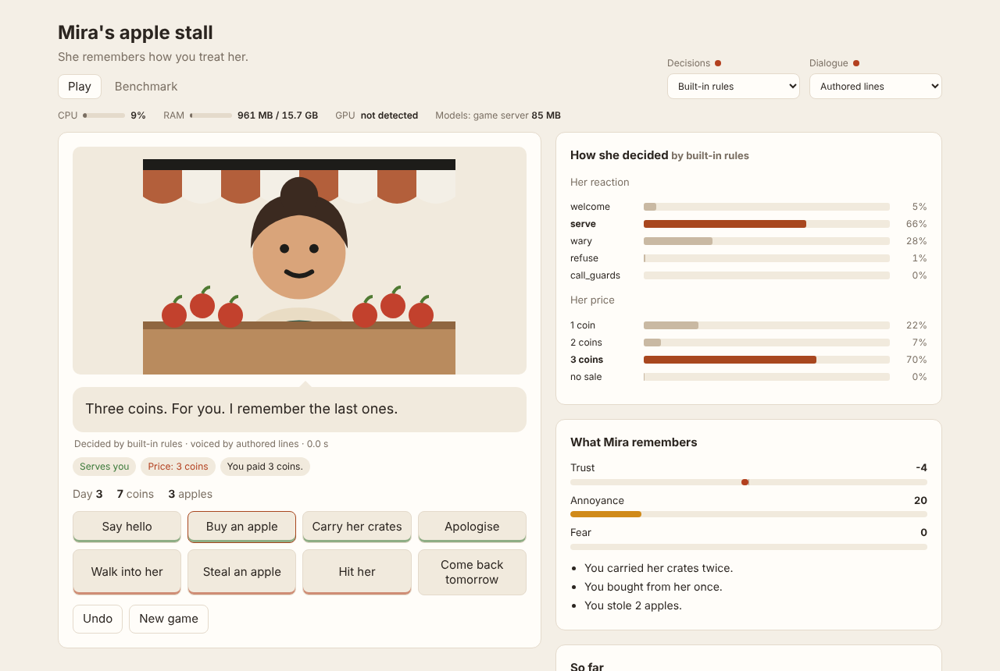

# npc-memory

Mira sells apples at a market stall, and she remembers how you treat her. Carry her crates and she gives you a discount. Steal from her and she charges you more, refuses to sell, or calls the guards.

It is a small prototype of an NPC whose behaviour comes from her history with the player. The sketch on my [research page](https://girhe.com/research#sketch-npc) uses scripted rules only; this version runs it with local AI models.



## How it works

Each turn has two steps.

1. A typed decision model decides. It reads Mira's history with the player and the current game state, and picks from the actions the game supports: how she reacts (`welcome`, `serve`, `wary`, `refuse`, `call_guards`) and, after a purchase, what she charges (`1 coin` to `no sale`). It returns a score for every option, so the game can use the answer directly. This runs on [GLiClass](https://github.com/Knowledgator/GLiClass), an open-source zero-shot classifier.
2. A small language model speaks. It is told what Mira decided and only puts that into words, so it can't change her mind or her price. It is prompted as Mira, talking to you, and anything that comes back as narration ("Mira glares at you...") is cut; if nothing she actually says is left, it gets one more try and then she uses an authored line. This runs on any model served by [Ollama](https://ollama.com), such as [Qwen3-0.6B](https://huggingface.co/Qwen/Qwen3-0.6B).

Either step can drop out. Without GLiClass, built-in rules make the decision. Without Ollama, she uses authored lines. The game is fully playable with neither.

The "How she decided" card next to her shows the score each reaction and price got. Open "Behind the scenes" to see the text the decision model read and the prompt the language model got.

A bar under the title shows CPU, RAM, GPU and VRAM use while you play, and how much memory each model takes. GPU numbers need an NVIDIA card with `nvidia-smi`; on other machines the bar says the GPU wasn't detected.

## Running it

You need Node 20 or newer.

```sh
npm ci
npm start
```

Then open http://localhost:4321.

That runs the built-in rules and authored lines. To add the models:

```sh
# the decision model (Python 3.10+; downloads the model on first run)
pip install -r decider/requirements.txt
python decider/server.py

# the language model
ollama pull qwen3:0.6b
```

Leave both running and reload the page. The two menus at the top pick which decision model and which language model Mira uses, and the dot next to each shows whether it is running.

GLiClass uses `knowledgator/gliclass-small-v1.0` by default and runs on the GPU if PyTorch can see one. Set `GLICLASS_MODEL` to try another GLiClass model, or `OLLAMA_HOST` and `DECIDER_URL` if the services run somewhere else.

## Benchmark

The Benchmark tab on the page plays a random game against Mira with whichever models are picked at the top, and times every turn. It shows how long the decision and the line take (median and 95th percentile), how long the first turn took while things warmed up, how fast the language model generates, how often either step fell back, and how much memory each model uses. The same seed always plays the same game, so you can compare models or machines. Results download as JSON.

The same thing runs from the command line and saves to `benchmarks/`:

```sh
npm run bench -- --turns 50 --decider gliclass --voice qwen3:0.6b
```

In Windows PowerShell, quote the separator: `npm run bench '--' --turns 50 ...`. Use `--decider rules` or leave out `--voice` to time the built-in rules or the authored lines.

## Layout

```
src/memory.ts     what Mira remembers and how each action changes it
src/decision.ts   step 1: the game state as text, the supported options, GLiClass and the fallback
src/rules.ts      the built-in decision rules
src/dialogue.ts   step 2: turning the decision into a line, with authored lines as the fallback
src/lines.ts      the authored lines
src/turn.ts       one turn: remember, decide, speak
src/bench.ts      the benchmark (src/bench-cli.ts runs it from the command line)
src/system.ts     CPU, RAM and GPU stats for the page
src/server.ts     local server for the page
decider/          GLiClass behind a small HTTP service
web/              the game page (plain HTML, CSS and JavaScript)
test/             tests, with the model services faked
```

## Tests

```sh
npm test
```

## License

MIT
